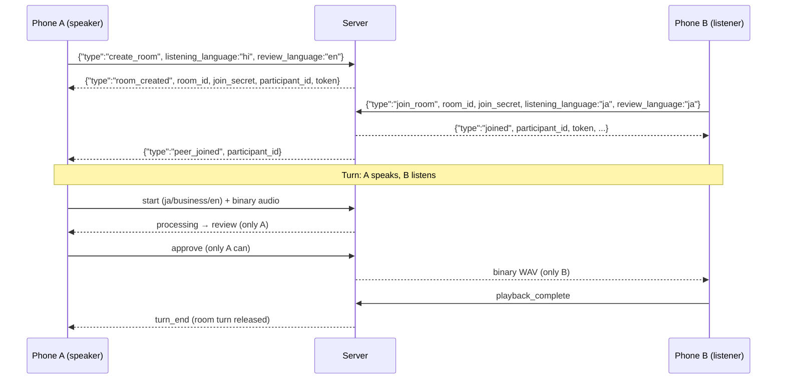

# Polyglot Voice — API Reference

The backend exposes **two REST endpoints** and **one WebSocket endpoint**. All JSON messages use `{"type": "<message_type>", ...}`. Binary WebSocket frames carry raw audio (client → server) or a complete WAV file (server → client).

- **Base URL (local):** `http://localhost:8000`
- **WebSocket URL:** `ws://localhost:8000/ws`
- **Interactive REST docs:** FastAPI auto-generates them at `/docs` (Swagger UI) and `/redoc`.

> **Authentication callout:** there is **no authentication on REST or WS in v1**. Room access is protected by join secrets + participant tokens, but the server itself must not be exposed to the public internet. The Flutter client can append a `?token=<demo-token>` query parameter to the WS URL for future use — the backend currently accepts and ignores it. Do not distribute provider keys to clients; they belong only in the backend's `.env`.

---

## 1. REST Endpoints

### `GET /health`

Liveness probe. No parameters.

**Response `200`:**

```json
{
  "status": "ok",
  "service": "polyglot-voice-engine",
  "version": "0.1.0"
}
```

### `POST /translate`

Text-only translation with back-translation (the core of the verification loop, usable without any audio). Back-translation targets English in v1.

**Request body:**

| Field | Type | Required | Constraints | Description |
|---|---|---|---|---|
| `text` | string | ✔ | 1–5000 chars after trimming | Source text (treated as content to translate, never as instructions) |
| `target_language` | string | ✔ | Allowlist: `ja`, `ko`, `hi`, `vi`, `en` | ISO-639-1 code; must have a cultural-matrix config |
| `tone` | string | ✖ (default `business`) | `formal`, `business`, `casual` | Point on the tone axis |

```bash
curl -X POST http://localhost:8000/translate \
  -H "Content-Type: application/json" \
  -d '{"text": "Aap kaise hain? Kal meeting 3 baje hai.", "target_language": "ja", "tone": "business"}'
```

**Response `200`:**

```json
{
  "translated_text": "お元気ですか？本日3時に会議があります。",
  "back_translation": "How are you? There is a meeting at 3 o'clock today."
}
```

**Error responses:**

| Status | When | Body |
|---|---|---|
| `422` | Unknown language, unknown tone, empty/oversized text, or FastAPI schema violations | `{"detail": "<message>"}` — e.g. `"Input text is too long (maximum 5000 characters)."` |
| `502` | Both Gemini and Groq failed (after fallback and cooldown logic) | `{"detail": "Translation failed: all providers unavailable. Try again later."}` — deliberately generic; raw SDK errors are never exposed |

> **Provider behavior:** Gemini 2.5 Flash is tried first; on timeout/network failure/rate limit/invalid output the request falls back to Groq Llama 3.3. After `PROVIDER_MAX_CONSECUTIVE_RATE_LIMITS` (2) consecutive rate-limit failures, a provider enters cooldown for `PROVIDER_COOLDOWN_SECONDS` (60 s) and traffic goes to the fallback. Per-call timing is logged: `forward_translation provider=gemini duration=0.64s chars=24`.

## 2. WebSocket Protocol

### 2.1 Connection & framing

- Endpoint: `ws(s)://<host>:8000/ws`. An optional `?token=<demo-token>` query parameter is accepted and **ignored** in v1 (reserved for backend access control).
- **Text frames** are JSON control messages of the form `{"type": "<message_type>", ...}`.
- **Binary frames** client → server are raw PCM16, mono, 16 kHz audio chunks (≈100 ms each in practice). Binary frames server → client are one complete WAV file.
- The first server message after connecting is always `{"type":"ready","session_id":"<uuid>"}`.
- **One active utterance per connection.** A `start` during an active turn returns `error` with `code: "server_busy"` (in rooms: a typed `busy` message). Malformed JSON or unknown types return `error` with `code: "invalid_message"`; the connection stays open.
- Audio beyond the server-side utterance cap (~15 s of speech) ends the turn automatically.

### 2.2 Client → Server messages

| `type` | Fields | Purpose |
|---|---|---|
| `start` | `target_language` (`ja`/`ko`/`hi`/`vi`/`en`), `tone` (`formal`/`business`/`casual`, default `business`), `review_language` | Begin an utterance turn (listening state) |
| `approve` | `utterance_id` | Approve the reviewed translation → triggers TTS. **Single-shot**: duplicate approvals are ignored, no second synthesis |
| `cancel` | `utterance_id` (optional; validated when present) | Cancel the active turn at any stage before playback |
| `ack` | `message_type` | Optional acknowledgement of a received server message |
| `create_room` | `listening_language`, `review_language`, `tone` | Create a room → returns `room_created` with credentials |
| `join_room` | *first join:* `room_id`, `join_secret` + prefs · *rejoin:* `room_id`, `participant_id`, `participant_token` + prefs | Join an existing room, or restore a disconnected session within the 120 s grace window |
| `update_prefs` | `listening_language`, `review_language`, `tone` | Change a participant's languages/tone mid-session |

Audio carries no JSON wrapper: after `start`, send binary PCM16 frames directly. Prefs fields on room messages default to `ja` / `en` / `business`.

### 2.3 Server → Client messages

| `type` | Fields | Purpose |
|---|---|---|
| `ready` | `session_id` | First message after connect |
| `processing` | `message` | End-of-speech detected; inference starting (sent immediately, before results) |
| `review` | `utterance_id`, `transcript`, `translated_text`, `back_translation`, `target_language`, `verification_window_ms` | Verification step — the only state from which approval is possible |
| `turn_end` | `reason` | Turn finished; `reason` ∈ `approved` · `cancelled` · `no_speech` · `error` · `peer_left` |
| `error` | `code`, `message` | Typed error; connection stays open (see §2.5) |
| `room_created` | `room_id`, `join_secret`, `participant_id`, `token` | Room created; **distribute `room_id` + `join_secret` out-of-band** |
| `joined` | `room_id`, `participant_id`, `token`, `listening_language`, `review_language`, `tone`, `rejoined` | Join/rejoin accepted; store `participant_id` + `token` for reconnect |
| `peer_joined` | `room_id`, `participant_id`, `rejoined` | The other participant is in the room |
| `peer_left` | `room_id`, `participant_id` | The other participant disconnected |
| `busy` | `message` | A competing `start` was rejected — the room turn is held by the peer |

After an approved turn, the server sends **one binary WAV frame** (22 050 Hz, 16-bit mono for current voices) followed by `turn_end`. Save/parse it with any WAV library — the Flutter client plays it via `audioplayers`.

### 2.4 Room message flow



A third participant joining a full room receives `error` with `code: "room_full"`. A rejoin after disconnect repeats `join_room` with `room_id` + `participant_id` + `participant_token` (no secret needed) within the 120 s grace window; the response's `rejoined: true` distinguishes it from a fresh join. Old approvals/audio are never replayed.

### 2.5 Error codes

| `code` | Meaning |
|---|---|
| `invalid_message` | Malformed JSON, unknown type, or schema violation |
| `invalid_audio` | Oversized or undecodable audio frame |
| `no_active_turn` | `cancel`/`approve` with no turn in progress |
| `invalid_utterance` | Utterance ID mismatch (stale or wrong turn) |
| `stt_failed` | Both local and cloud transcription failed |
| `translation_failed` | All translation providers failed |
| `tts_failed` | Synthesis failed for the target language |
| `rate_limited` | Too many join attempts from this connection |
| `server_busy` | Second `start` during an active turn (single-client mode) |
| `room_not_found` | Unknown or expired room ID |
| `room_full` | Room already has two participants |
| `invalid_secret` | Wrong `join_secret` |
| `invalid_credentials` | Bad `participant_id`/`token` pair on rejoin |
| `not_authenticated` | Room-required action without a joined room |
| `not_turn_owner` | A non-speaker attempted to approve the speaker's turn |

Errors are **typed and non-fatal** — the connection remains open unless the transport itself fails.

## 3. Authentication Summary

| Surface | v1 mechanism |
|---|---|
| REST `/translate`, `/health` | None — keep the server off the public internet |
| WebSocket `start`/audio | None beyond the connection itself |
| Room creation/join | `join_secret` (high-entropy) |
| Rejoin | `participant_id` + `participant_token` (server-issued, constant-time compared) |
| Room actions | Server-assigned participant identity; client-supplied IDs are never trusted |

The `?token=` WS query parameter is accepted and **ignored** — reserved for future backend access control.

## 4. Client-Side Timing Logs

`mic_client.py` prints two client-side stages to complement the server's `TIMING` lines:

```
TIMING-CLIENT turn=<id> stage=review_wait review_wait_ms=2150
TIMING-CLIENT turn=<id> stage=delivery approve_to_audio_ms=512
```

`review_wait` = speech-end → review presented (network included). `delivery` = approval → audio frame received. Together with the server's `stt_ms` / `forward_ms` / `back_ms` / `tts_ms`, these are the fields for the README's latency table. Cancelled turns produce `review_wait` but no `tts`/`delivery` lines — no TTS runs without approval.

---

*Continue reading: [Setup Guide](setup-guide.md) · [Architecture](architecture.md) · [Overview](README.md)*
