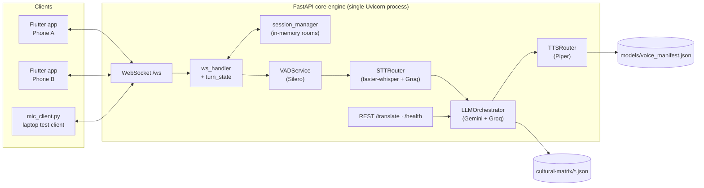
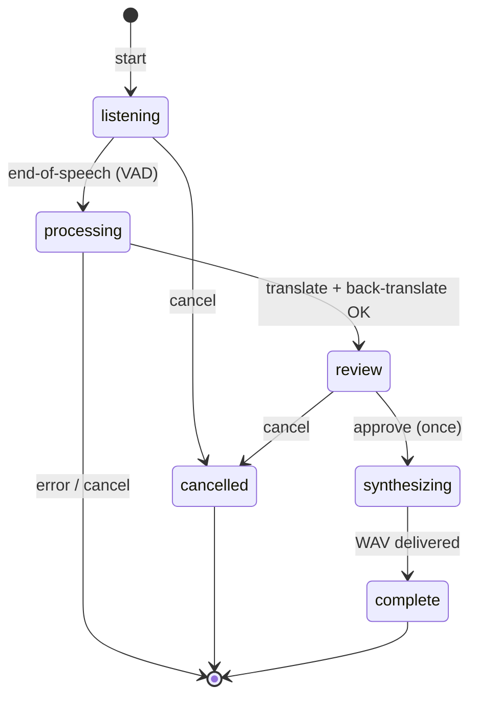
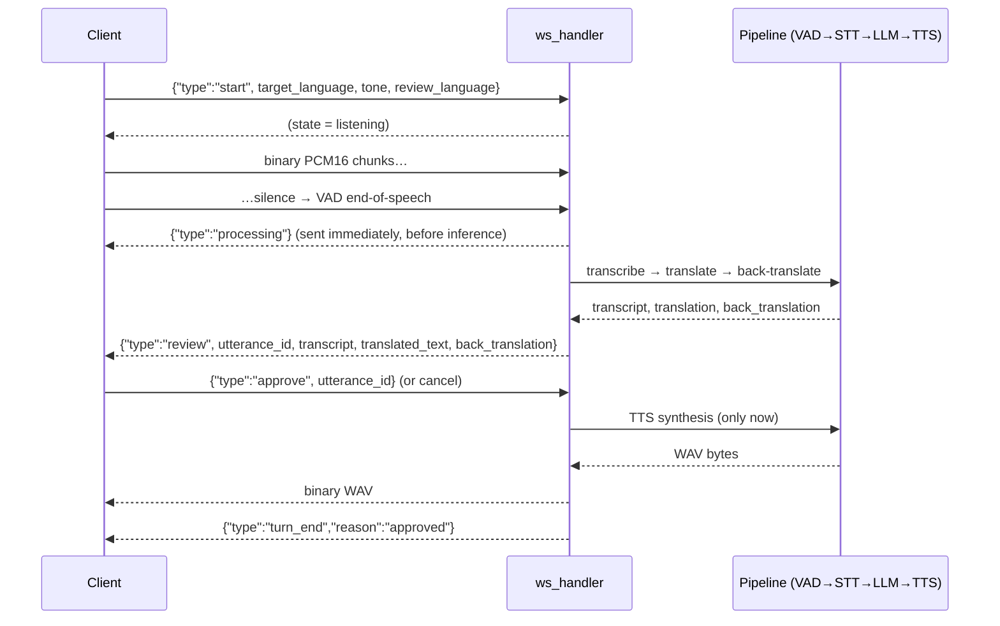

# Polyglot Voice — Architecture

**Audience:** developers evaluating, extending, or debugging the system.
**Scope:** the code as it exists at v0.1.0 — a single-process FastAPI backend, a Flutter client, and declarative configuration files. Everything described here maps to a real file; nothing is aspirational.

Polyglot Voice is a **verify-then-speak** voice translator. Audio is transcribed, translated by an LLM, back-translated as a human-readable receipt, and only synthesized into speech after the speaker approves. The architecture's defining constraints are: provider-swappable by design, zero-budget by default, and honest about its limits (single process, in-memory rooms, half-duplex turns).

---

## 1. System Overview



- **Client → server:** raw PCM16 mono 16 kHz audio chunks + small JSON control messages.
- **Server → client:** JSON control messages + one WAV file per approved turn.
- **Server → cloud (optional):** Gemini/Groq API calls when keys are configured; STT/TTS defaults are fully local.

## 2. Component Map

| Component | File | Responsibility |
|---|---|---|
| App entry | `core-engine/app/main.py` | `/health`, `/translate`, `/ws`, room-reaper task, logging config |
| Settings | `core-engine/app/config.py` | Every env-driven setting via pydantic-settings; **no keys in code** |
| Provider contracts | `app/services/base_interfaces.py` | Abstract `BaseSTTProvider` / `BaseTranslationProvider` / `BaseTTSProvider` |
| Turn pipeline | `app/services/ws_handler.py` | One receive loop per connection; VAD→STT→LLM→TTS orchestration; room routing; TIMING logs |
| Turn state | `app/services/turn_state.py` | State machine; **one active turn per connection**; single-approval rule |
| Protocol | `app/services/ws_protocol.py` | Pydantic models for every WS message; `MessageType`/`ErrorCode` enums |
| Rooms | `app/services/session_manager.py` | Create/join/rejoin, join secrets, participant tokens, rate limiting, expiry |
| VAD | `app/services/vad_service.py` | Silero VAD; per-stream state; speech endpoints |
| STT | `app/services/stt_router.py` | Local faster-whisper with bounded timeout → Groq Whisper fallback |
| LLM | `app/services/llm_orchestrator.py` | Gemini→Groq fallback, cooldown, cultural tone injection, back-translation |
| TTS | `app/services/tts_router.py` | Piper voices from the manifest; language routing; WAV output |
| Tone configs | `cultural-matrix/{ja,ko,hi,vi,en}.json` | Tone axis + preservation rules per language |
| Voice catalog | `core-engine/models/voice_manifest.json` | Declares which voices exist, where to download, license |
| Test clients | `mic_client.py`, `test_phase{1,2,3,4,5,7}.py` | Laptop mic client; layered test suites |

## 3. Turn Lifecycle

A *turn* is one utterance from "user starts speaking" to "audio delivered" or "cancelled". State is owned by `TurnManager` (one per WebSocket connection) and is the single source of truth for what is allowed next.



Sequence for a single client (room mode changes delivery, not the core stages):



Invariants enforced by the state machine:

1. **One active turn per connection.** A second `start` is rejected with `server_busy`.
2. **Approval is single-shot.** A duplicate `approve` for the same utterance never triggers a second synthesis.
3. **Late results can't revive cancelled turns.** Every pipeline stage checks the turn's cancellation flag before proceeding; a cancel mid-processing discards results.
4. **No TTS before approval** — the TTS router is unreachable from the review state (regression-tested).
5. Silence-only input ends the turn with `{"type":"turn_end","reason":"no_speech"}` without invoking STT/LLM.

## 4. Provider Abstraction & Fallback

All external intelligence is reached through three abstract interfaces in `app/services/base_interfaces.py`:

| Interface | Implementations | Input → Output |
|---|---|---|
| `BaseSTTProvider` | `FasterWhisperProvider` (local), `GroqWhisperProvider` (cloud) | PCM16 mono 16 kHz bytes → transcript |
| `BaseTranslationProvider` | `GeminiProvider`, `GroqLLMProvider` | text + language + tone → structured translation |
| `BaseTTSProvider` | `PiperProvider` | text + language → WAV bytes |

Calling code (`ws_handler.py`, `main.py`) only ever sees these interfaces — swapping a provider is a factory change, not a call-site rewrite.

**Fallback eligibility:** timeout, network failure, rate limit, temporary provider failure, unavailable model, or structurally invalid output (after bounded handling). A provider's *safety refusal is never* a fallback trigger. If every eligible provider fails, the caller gets a **typed error** — never an empty 200.

### STT fallback with honest timeouts

faster-whisper runs in a worker thread; awaiting it with a timeout does **not** stop the inference. The design accepts this instead of pretending otherwise:

- Local concurrency is **bounded**; a request arriving when all worker slots are busy gets a typed busy error rather than queueing without limit.
- A timed-out request falls back to Groq immediately, but the local slot stays occupied until the real task finishes. The late local result is **discarded** once the cloud answer wins, and slots are only reused after work actually completes — no unbounded background thread accumulation.
- Cloud STT is gated by `ALLOW_CLOUD_STT`. With it `false`, audio never leaves the machine and the fallback surfaces as a typed `stt_failed` error instead of a cloud call.

Local models are multilingual (`small`, `int8`, CPU-first), run in **transcription mode** (never Whisper's translation task), and do **not** force a single language — that is what makes code-switched Hinglish/Vietnamese-English input workable. Silence-only audio never reaches Whisper.

### LLM fallback and cooldown

`LLMOrchestrator` tries Gemini 2.5 Flash, then Groq Llama 3.3. Responses are validated with Pydantic; malformed output counts as a failure and falls through. After `PROVIDER_MAX_CONSECUTIVE_RATE_LIMITS` (2) consecutive rate-limit failures a provider enters cooldown for `PROVIDER_COOLDOWN_SECONDS` (60 s) and is skipped — protecting the free-tier quota instead of hammering it. It re-enters rotation automatically when the window expires. Per-call logs carry the provider, duration, and character count (`forward_translation provider=gemini duration=0.64s chars=24`) — no message text.

## 5. Cultural Tone Injection

Tone is data, not code. `cultural-matrix/<lang>.json` files (validated against `schema.json`) hold:

- **One tone axis per language** with three points: `formal`, `business`, `casual` — no per-tone file explosion.
- **Shared preservation rules** — names, numbers, currencies, dates, negation, and commitments survive translation; intent over literal word order; never invent gender, relationship, status, or promises; keep technical/product names; politeness matched to the selected tone.
- **Language-specific guidance** — Japanese honorific restraint, Korean speech-level consistency without invented hierarchy, Hindi respectful/familiar address, Vietnamese age/relationship-safe pronouns, English tone-through-phrasing.
- Optional examples and notes.

`LLMOrchestrator` composes the system prompt from the selected language + tone rules and delivers the user text **separately delimited as content to translate — never as instructions**. Output is parsed as structured data and validated with Pydantic; there is no `eval` and no regex "repair" of broken JSON.

The language allowlist is exactly the set of config files (`ja`, `ko`, `hi`, `vi`, `en`). Unknown codes are rejected with `422` before any provider call; no filesystem path is ever built from unchecked user input.

> These files are configurable writing conventions, not claims that everyone in a culture speaks one way — the README states this explicitly.

## 6. Rooms & Two-Participant Sessions

Rooms live **entirely in memory** in `session_manager.py` — there is no database, no Redis, and this is deliberate for a single-worker portfolio build. Run **one Uvicorn process**; multiple workers would hold disjoint room tables.

**Security model (defense in depth, scaled to a local demo):**

1. A room is identified by a short human-friendly `room_id` — spoken aloud, easy to type. **It is not a credential.**
2. Creation returns a high-entropy `join_secret` (`secrets.token_urlsafe`). Joining requires room_id + secret.
3. On join, the server assigns the participant ID and issues a per-participant `token`. Clients **never** supply their own IDs; rejoin verifies the ID+token pair with `secrets.compare_digest`.
4. Join attempts are rate-limited per connection.
5. Provider keys never appear in join URLs or any client-visible message.

**Half-duplex turn policy.** One active room turn at a time, held until the *listener* confirms playback:

- The first valid `turn.start` acquires the room turn; a competing start gets a typed `busy` message.
- Only the **speaker** sees the review/approval prompt; only the **listener** receives the approved audio.
- The room turn releases on: listener `playback_complete`, cancellation, playback timeout (`PLAYBACK_TIMEOUT_SECONDS`), or disconnect.

**Reconnect.** A disconnect keeps the participant's identity and preferences in the room for `RECONNECT_GRACE_SECONDS` (120 s) and cancels any pending work immediately — the peer is notified (`peer_left` / `turn_end reason=peer_left`) and audio is never delivered to a departed socket. Rejoining restores membership; approvals and audio from before the disconnect are **never replayed**. Rooms expire when empty (`ROOM_EMPTY_EXPIRY_SECONDS`).

**Language routing** follows the participants' preferences, not the speaker's: A (listening `hi`, review `en`) speaks to B (listening `ja`, review `ja`) → forward translation targets `ja`, back-translation targets `en`, only A approves, only B hears the audio.

## 7. Verification Safety Loop

The defining UX of the product is the pause between translation and speech:

1. The speaker sees `transcript`, `translated_text`, and `back_translation` — a reverse rendering of the translation back into their review language.
2. A countdown (`verification_window_ms`, 800 ms default) begins **only after the review is presented**; expiring it approves, tapping cancels, and manual buttons exist for countdown-free review.
3. **No TTS call exists before approval.** This is a hard invariant with a regression test; the TTS router is unreachable from the review state.

This loop is a *human safety check* — it catches tone mistakes, wrong names, and mistranslated commitments before they are spoken. It is a UX safeguard, not a formal correctness guarantee; the README says so plainly.

## 8. Observability

Per-turn stage timing is logged (INFO level, configured in `main.py`) without any conversation content:

```
TIMING turn=<uuid> stage=to_review stt_ms=812 forward_ms=640 back_ms=590 total_to_review_ms=2042
TIMING turn=<uuid> stage=tts tts_ms=430
```

Plus per-LLM-call lines (`forward_translation provider=gemini duration=0.64s chars=24`) and client-side stages in `mic_client.py` (`review_wait_ms`, `approve_to_audio_ms`). Logs carry request/session IDs, provider names, durations, and sanitized error codes — never transcripts, audio, or credentials.

## 9. Technology Choices and Their Trade-offs

| Choice | Why | Trade-off accepted |
|---|---|---|
| faster-whisper `small` int8, CPU | Zero cost, code-switched input via multilingual models | Slower than cloud; bounded timeout + Groq fallback mitigates |
| Silero VAD (local) | Free, tiny, per-stream state | Endpoint tuning is per-environment; values are starting points |
| Gemini 2.5 Flash + Groq fallback | Free tiers; factory pattern keeps them swappable | Free-tier terms may permit provider-side data use on text |
| Piper TTS | Local, free, per-language voices | GPL license; voice quality below paid clouds; language set limited by validated voices |
| In-memory rooms | No infra, trivially debuggable | Single worker; rooms vanish on restart |
| WebSocket (not WebRTC) | Simplicity: one protocol for control + audio | Higher latency than peer-to-peer media; fine for turn-based speech |

## 10. What v1 Deliberately Excludes

Bluetooth stereo splitting, simultaneous interpretation, speaker diarization, voice cloning, persistent history, user accounts, databases/Redis, paid cloud TTS, auto-upgrades to paid APIs, and production deployment infrastructure. Each would add complexity without helping the first portfolio demonstration. Claims of medical/legal translation safety are out of scope and out of the docs.

---

*Continue reading: [Setup Guide](setup-guide.md) · [API Reference](api-reference.md) · [Overview](README.md)*
